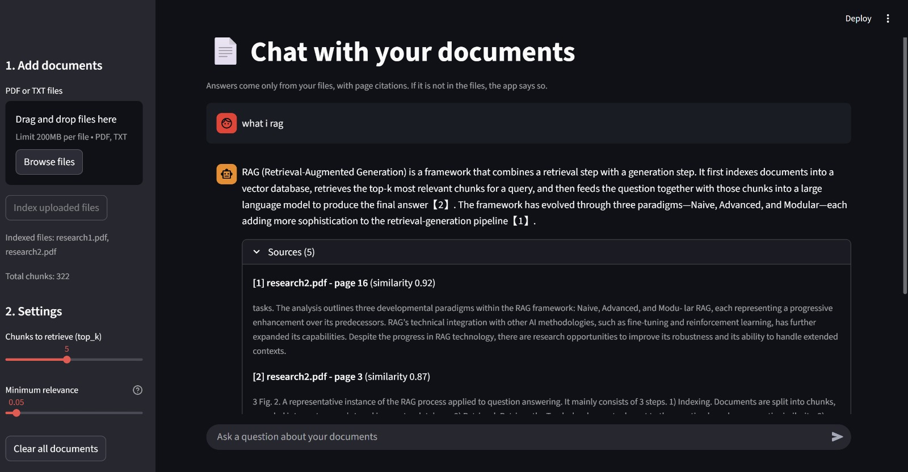
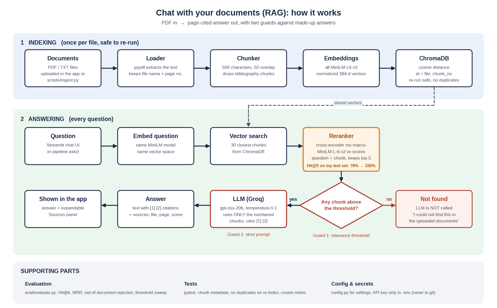
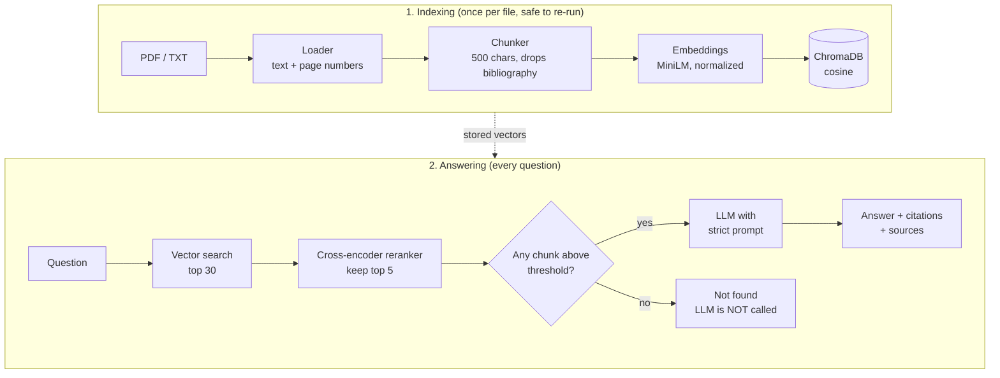

# Chat with your documents (RAG with reranking)

Ask questions about your PDFs and get answers **with page citations**.
If the answer is not in the documents, the app says so instead of making something up.



<!-- Live demo: add your Streamlit Community Cloud link here once deployed -->

**Stack:** Python, ChromaDB (cosine), sentence-transformers (`all-MiniLM-L6-v2` embeddings, `ms-marco-MiniLM-L-6-v2` cross-encoder reranker), LangChain components, Groq LLM, Streamlit.

## Why this project

Most RAG demos stop at "it returns an answer". This one focuses on **measuring** whether retrieval works, finding why it fails, and fixing it:

- an evaluation script (Hit@k, MRR, out-of-document rejection) with a threshold sweep
- three real bugs found and fixed (listed below)
- a two-stage retriever (vector search, then reranking) that raised Hit@5 from 78% to 100% on my test set
- two layers of protection against made-up answers

## How it works



<details>
<summary>Same diagram as editable text (Mermaid)</summary>



</details>

1. **Index:** pages are extracted with page numbers, split into ~500-character chunks, bibliography chunks are removed, and the rest are embedded and stored in ChromaDB.
2. **Retrieve:** the question is embedded, the 30 closest chunks are fetched, and a cross-encoder re-scores each (question, chunk) pair. Chunks below the threshold are dropped.
3. **Refuse or answer:** if nothing survives, the app says it cannot find the answer and the LLM is never called. Otherwise the LLM answers using only the numbered passages and cites them as `[1]`, `[2]`.

## Quick start

```bash
git clone https://github.com/bhardwajarpit888-hash/rag-project.git
cd rag-project

python -m venv .venv
.venv\Scripts\activate            # macOS/Linux: source .venv/bin/activate
pip install -r requirements.txt

copy .env.example .env            # macOS/Linux: cp .env.example .env
# then open .env and add your GROQ_API_KEY (free key: https://console.groq.com/keys)

# put one or more PDFs in data/pdfs/, then:
python -m scripts.ingest data/pdfs
streamlit run app.py
```

The first run downloads two small models (about 90 MB each). If you are offline after that, set `HF_HUB_OFFLINE=1` in `.env` to skip the network checks. Do not set it on the first run.

Other LLM providers: set `LLM_PROVIDER` to `openai` or `ollama` in `.env` (see `.env.example`).

## Evaluation

The test set (`eval/questions.json`) has 18 questions answerable from the survey paper
*Retrieval-Augmented Generation for Large Language Models: A Survey* (arXiv 2312.10997), each with the correct page numbers,
plus 10 questions that are **not** in the documents and must be refused. Metrics:

- **Hit@5:** is a chunk from a correct page in the top 5?
- **MRR:** how high is the first correct chunk ranked? (1.0 is best)
- **Rejected:** how many out-of-document questions return no chunk at all?

| Setup | Hit@5 | MRR | Out-of-document rejected by retrieval |
|---|---|---|---|
| Vector search only (min_score 0.25) | 78% (14/18) | 0.66 | 80% (4/5)* |
| + cross-encoder reranker (min_score 0.05) | **100% (18/18)** | **0.86** | 80% (8/10) |

\*Measured before the 5 harder out-of-document questions were added.

Of the two out-of-document questions that still passed retrieval (a Kubernetes question and a GPU question), the LLM's strict prompt refused both, so all 10 were refused end to end.

Reproduce it:

```bash
# save the survey as data/pdfs/research2.pdf (PDFs are not stored in this repo), then
python -m scripts.ingest data/pdfs
python -m eval.evaluate --sweep
```

The second paper in my index is the original RAG paper (Lewis et al., arXiv 2005.11401); the test questions only cover the survey.

## What I found and fixed

| Problem | Symptom | Fix |
|---|---|---|
| Chroma defaults to **L2 distance**, but scores were computed as `1 - distance` (valid only for cosine) | Relevant chunks got very low or negative scores and were thrown away; a simple question returned 0 documents | Collection created with cosine distance; a unit test checks it |
| **Duplicate indexing:** random IDs meant every re-run added the same chunks again | Index grew from 402 to 1608 chunks; the same chunk appeared 4 times in the top 5 | IDs are `file::chunk_number` and a file's old chunks are deleted before re-adding |
| **Bibliography chunks** matched questions by accident (author names, titles) | About 27% of the survey's chunks were references; they appeared in the top results | Heuristic filter at chunking time (402 to 322 chunks in total) |
| Right chunk existed but ranked #12 to #40 behind generic intro chunks | 5 questions missed, and `k=8` did not help | Added the reranker: Hit@5 78% to 100% |

## Design decisions

- **Refuse before generating.** If no chunk passes the threshold the LLM is not called. It is cheaper and the strongest guard against invented answers.
- **Two guards, not one.** The reranker measures whether a chunk is on the same topic as the question, not whether it contains the answer. Two out-of-document questions scored 0.68 and 0.89. The strict prompt is the second guard that caught them.
- **Numbered citations.** Every passage is numbered; the model cites `[1]`, and the UI shows the same numbered sources with file name and page.
- **Threshold chosen from a sweep, not by guessing.** Hit@5 stays at 100% from 0.01 to 0.10 and drops at 0.20, so 0.05 sits in the middle of the plateau.
- **Settings in one place** (`config.py`); secrets only in `.env`, never in code or git.

## Project structure

| File | Job |
|---|---|
| `config.py` | all settings in one place |
| `rag/loader.py` | PDF/TXT to text, keeping file name and page number |
| `rag/chunker.py` | splits pages into chunks, removes bibliography chunks |
| `rag/embeddings.py` | text to vectors |
| `rag/vector_store.py` | ChromaDB wrapper (cosine, safe re-indexing) |
| `rag/retriever.py` | vector search plus optional reranker, score threshold |
| `rag/generator.py` | strict prompt, citations, refusal |
| `rag/llm.py` | Groq / OpenAI / Ollama switch via `.env` |
| `rag/pipeline.py` | connects everything |
| `app.py` | Streamlit chat UI |
| `scripts/ingest.py` | command-line indexing |
| `eval/` | evaluation script and test questions |
| `tests/` | automated tests (`pytest -q`) |

## Known limitations

- **Small test set** (28 questions). The threshold was tuned on the same set, so the 100% figure is optimistic. A held-out set would be the next step.
- One test label was corrected after inspecting the retrieved text (the Naive RAG drawbacks question accepts pages 2 and 3).
- Only retrieval and refusal are scored automatically. **Answer faithfulness is not measured.**
- The bibliography filter is a heuristic tested on one paper; other citation styles may slip through.
- Scanned PDFs are not supported (no OCR).
- The index is rebuilt per file; there is no incremental update for edited pages.
- A Dockerfile is included but I have not tested it end to end.

## Roadmap

Hybrid search (BM25 plus vectors), answer-quality evaluation (faithfulness), a held-out test set, OCR for scanned PDFs, FastAPI endpoint, deployment.

## Tests

```bash
pytest -q
```

The tests check chunk metadata, unsupported file types, that re-indexing the same file does not create duplicates, and that the vector store really uses cosine distance.
